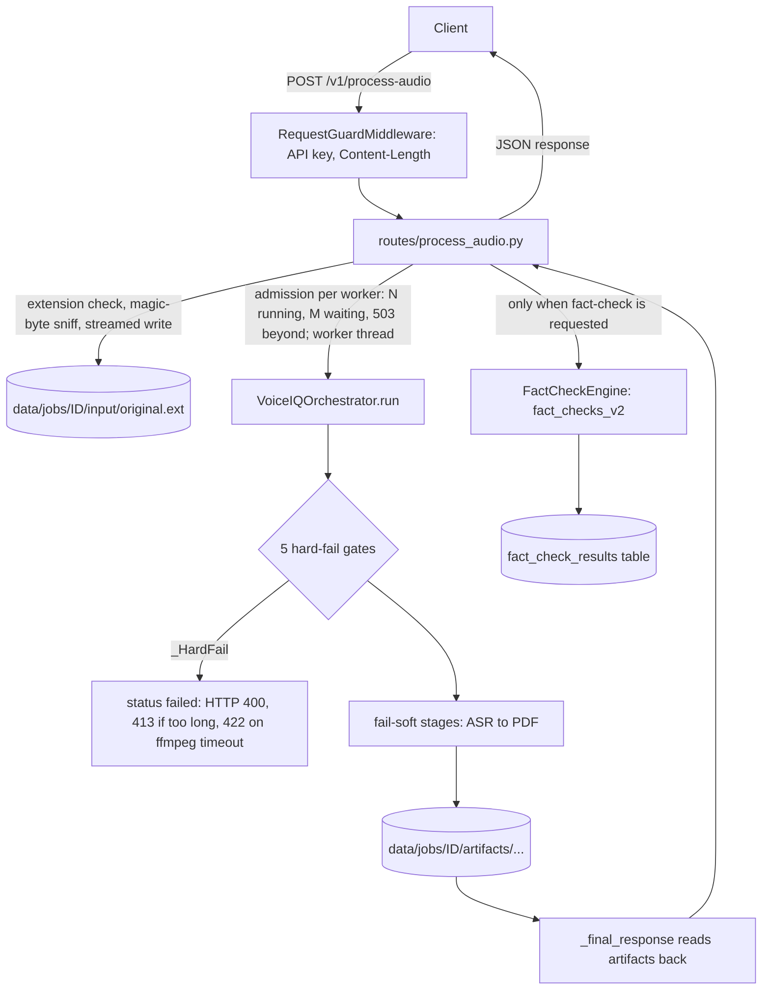

Last verified: 2026-10-24, 9887e0b
# Architecture

This document describes the code structure of VoiceIQ at commit `9887e0b`
(branch `sprint7/diarization-fix`, cut from `main` at `6e92898`; its code differs from `main` only in the diarization fix). It shows how the packages fit together, how data
moves between them, where faults are contained, what is stored, and how to
extend the system without breaking it.

[02-architecture.md](02-architecture.md) is the historical Sprint 1–4 view.
It was written before the fact-check engine, the Agent Brain and the
orchestrator decomposition, so use this document for the current state.
Anything that exists only as a plan is labelled **planned, not built**.

Related: [CLAUDE.md](../CLAUDE.md) (project brief), [README.md](../README.md),
[DATA-FLOW.md](DATA-FLOW.md) (every egress point), [SECURITY.md](SECURITY.md),
[DECISIONS.md](DECISIONS.md).

---

## 1. Two entry points

There are two FastAPI apps. They share the Insight Service and the Agent
Brain. Only one of them can process audio.

| | `app/main.py` | `app/insight_main.py` |
|---|---|---|
| Purpose | Full pipeline: audio in, analysis out | Insight Service and Agent Brain only, no audio stack |
| Routers mounted | process-audio and insights/fact-check under `/v1`, plus the Agent Brain router (`main.py:64-69`) | insights/fact-check under `/v1`, plus the Agent Brain router (`insight_main.py:76-80`) |
| Middleware | `RequestGuardMiddleware`, including the upload cap for `/v1/process-audio` (`main.py:72`) | `RequestGuardMiddleware`, without `/v1/process-audio` (`insight_main.py:83`) |
| Python dependencies | `requirements.txt` (includes whisper, torch, pyannote.audio, transformers) | `requirements-insight.txt` (FastAPI, SQLAlchemy, httpx, slowapi, fpdf; no ML libraries) |
| Startup (`lifespan`) | `configure_logging()`, `init_db()`, then `run_retention()`: a sweep of expired job folders and stored records now, then hourly in the background until shutdown (`main.py:32-42`) | the same (`insight_main.py:45-53`) |
| Run by | no bundled config; start it when `/v1/process-audio` is needed | the bundled `Dockerfile` (`Dockerfile:89`) |

Both apps serve `/healthz`, `/readyz` and `/version` directly on the app,
outside the protected routers (`main.py:75-91`, `insight_main.py:86-102`).
`/readyz` checks the database and, on `app.main` only, that `ffmpeg` is on
PATH (`app/utils/readiness.py`). Both turn off
`/docs`, `/redoc` and `/openapi.json` when `environment` is `production`
(`main.py:47-52`, `insight_main.py:58-63`).

## 2. Package map

```
app/main.py ─┬─ app/routes/process_audio.py ── app/pipeline/orchestrator.py ─┬─ app/services/*
             │                                                               ├─ app/insights  (adapter + InsightService)
             │                                                               └─ app/agent_brain (opt-in stage + callback)
             ├─ app/insights/api      (insights + fact-check routers, under /v1)
             └─ app/agent_brain/api   (internal router, /internal/v1/agent-brain)

app/security  request guard middleware on both apps, plus the guards every router declares as FastAPI dependencies
app/utils     per-job workspace, logging, audio helpers, upload and fact-check gates, retention sweep, readiness checks, whole-word matching
```

| Package | Role | Key files |
|---|---|---|
| `app/routes` | The only audio route, `POST /v1/process-audio` | `process_audio.py` |
| `app/pipeline` | Runs the audio pipeline stage by stage | `orchestrator.py` (`VoiceIQOrchestrator`, `_PipelineState`, `_HardFail`) |
| `app/services` | One class per pipeline step: ASR, diarization, alignment, metadata stats, sentiment, keywords, gender, emotion, topic, summary, intent, flags, legacy fact-check candidates, PDF | `asr_service.py`, `diarization_service.py`, `alignment_service.py`, `pdf_service.py`, … |
| `app/insights/core` | Insight engines: analytics, signal aggregation, rule engine, timeline, escalation, inconsistency, scoring, summary, normalizer, validator; shared `clamp` in `_math.py` | `rule_engine.py`, `_math.py` |
| `app/insights/core/factcheck` | Rule-based fact-check engine: claim detector, classifier, comparator, scorer, engine, and five source clients | `factcheck_engine.py`, `claim_detector.py`, `source_clients/` |
| `app/insights/models` | Pydantic models, one file per concern | `input_models.py`, `insight_models.py`, `factcheck_models.py`, … |
| `app/insights/api` | Insight and fact-check routers, combined into one router (`api/__init__.py:10-12`); the insight router parses JSON bodies with finite numbers only | `insight_routes.py`, `factcheck_routes.py`, `finite_json.py` |
| `app/insights/repository` | SQLAlchemy engine, ORM models and two repositories | `db.py`, `orm_models.py`, `factcheck_orm_models.py`, `insight_repository.py`, `factcheck_repository.py` |
| `app/insights/config` | `InsightSettings` (env prefix `VOICEIQ_`, `settings.py:28-38`) and default insight thresholds (`defaults.py`) | `settings.py`, `defaults.py` |
| `app/insights/adapters` | Turns orchestrator output into a `SessionInput` (`voiceiq_adapter.py:76`) | `voiceiq_adapter.py` |
| `app/insights/service.py` | `InsightService`: validate, then analytics → rules → summary | `service.py` |
| `app/agent_brain/core` | Five rule-based agents plus confidence refinement, de-duplication, ranking and the runner | `agent_runner.py`, `base_agent.py`, `*_agent.py` |
| `app/agent_brain/extraction` | Signal matching, assignee, date/time phrase, deadline resolution, priority, language routing | `signals.py`, `datetime_resolver.py`, `language.py` |
| `app/agent_brain/models` | Input (`AgentContext`) and output (`Recommendation`) contracts, camelCase on the wire (`models/base.py`) | `agent_context.py`, `recommendation.py`, `enums.py` |
| `app/agent_brain/adapters` | Builds an `AgentContext` from `SessionInput`, `InsightBundle` and an optional `FactCheckResponse` | `pipeline_adapter.py` |
| `app/agent_brain/integrations` | HMAC-signed callback to the Java Action Layer | `java_callback_client.py` |
| `app/agent_brain/api`, `config`, `service.py` | Internal route, `AgentBrainSettings` (env prefix `VOICEIQ_AGENT_`, `config/settings.py:14`), `AgentBrainService` | |
| `app/security` | API-key check, Content-Length cap, rate limits, and the middleware that runs the key and size checks before a body is read | `api_key.py`, `payload_size.py`, `rate_limit.py`, `request_guard.py` |
| `app/utils` | `JobIO` per-job workspace, logging setup (`configure_logging` applies `VOICEIQ_LOG_LEVEL` at startup), ffmpeg normalisation and the audio length limit, audio-quality check, magic-byte sniff, upload filename check, fact-check opt-in gate, the retention sweep for job folders and stored records (`sweep`, `run_retention`), the `/readyz` checks, and whole-word keyword matching for the flag, intent and email-draft rules (`contains_phrase`, `starts_with_phrase`) | `job_io.py`, `logger.py`, `audio_utils.py`, `audio_quality.py`, `audio_sniff.py`, `upload.py`, `factcheck_gate.py`, `retention.py`, `readiness.py`, `text_match.py` |

Two modules sit outside the request path: `app/evaluation/evaluator.py` is
used by the repository-root script `run_eval_dev.py` (line 8), and
`app/models/response_model.py` is not imported by any module under `app/`.

## 3. Routes

| Route | Declared at | Mounted by |
|---|---|---|
| `POST /v1/process-audio` | `app/routes/process_audio.py:129` | `main.py` only |
| `POST /v1/insights/generate` | `app/insights/api/insight_routes.py:63` | both apps |
| `POST /v1/insights/generate-from-raw` | `insight_routes.py:84` | both apps |
| `GET /v1/insights/{session_id}` | `insight_routes.py:105` | both apps |
| `GET /v1/insights/{session_id}/summary` | `insight_routes.py:124` | both apps |
| `GET /v1/insights/{session_id}/speakers` | `insight_routes.py:150` | both apps |
| `GET /v1/insights/{session_id}/timeline` | `insight_routes.py:179` | both apps |
| `GET /v1/insights/` | `insight_routes.py:203` | both apps |
| `DELETE /v1/insights/{session_id}` | `insight_routes.py:217` | both apps |
| `POST /v1/fact-check` | `app/insights/api/factcheck_routes.py:83` | both apps |
| `GET /v1/fact-check/{conversation_id}` | `factcheck_routes.py:121` | both apps |
| `POST /internal/v1/agent-brain/recommendations/generate` | `app/agent_brain/api/agent_routes.py:38` | both apps (mounted in `df8eec3`, added to the light app in `1774209`) |
| `GET /healthz`, `GET /readyz`, `GET /version` | `main.py:75,80,85`; `insight_main.py:86,91,96` | each app (`/readyz` added in `660558c`) |

Each router declares its guards as FastAPI dependencies from `app/security`
(for example `process_audio.py:63-68`, `insight_routes.py:41-49`,
`agent_routes.py:25-33`). FastAPI reads and parses a request body before it
resolves those dependencies (`app/security/request_guard.py:3-5`), so both
apps also install `RequestGuardMiddleware`, which runs before routing:

```
request ─► RequestGuardMiddleware ─► routing ─► body parsing ─► router dependencies ─► handler
           (POST/PUT/PATCH under                (insights:      (API key, Content-Length,
            a guarded prefix)                    finite only)    then any rate limit)
```

- **Guarded prefixes** (`request_guard.py:38-48`): `/v1/insights`,
  `/v1/fact-check` and `/internal/v1/agent-brain`, capped by
  `api_max_session_payload_kb` (default 2048 KB), and on `app.main` only
  `/v1/process-audio`, capped by the upload limit.
- **Checks** (`request_guard.py:65-81`): the API-key check, then the
  Content-Length check, before the body reaches the app. They share
  `api_key_error` and `content_length_error` with the router dependencies
  (`app/security/api_key.py:63-96`, `app/security/payload_size.py:63-95`), so
  the status and detail are the same. A refusal carries `Connection: close`
  and the body is not read, so a client that is still sending a large body
  can see a connection reset instead of the status. Callers such as the
  Java backend should send `Expect: 100-continue` with large uploads (uvicorn
  then answers before the body is sent), or read the response when a send
  fails.
- **Passing requests** (`request_guard.py:83-101`): the body bytes are
  counted, and a body longer than its declared length gets 413.
- **Effect of running before routing:** an unauthenticated request with an
  invalid body gets the auth error instead of 422, and a body-method request
  to an unknown path under a guarded prefix gets the auth or size error
  instead of 404 or 405 (`request_guard.py:13-15`).

`app/insights/tests/test_request_guard.py` pins this (`ff874de`). The router
dependencies stay in place: they cover GET and DELETE and keep the OpenAPI
security scheme. The `/v1/insights` router also uses `FiniteJSONRoute`
(`insight_routes.py:44`, `app/insights/api/finite_json.py:32-49`): a JSON
body with `NaN`, `Infinity` or a number that overflows to infinity gets the
standard 422 `json_invalid` error while parsing. What the guards do, and their
limits, is covered in [SECURITY.md](SECURITY.md). Request and response fields:
[05-api-reference.md](05-api-reference.md) (historical) and the route code.

## 4. Data flow: `POST /v1/process-audio`



### 4.1 Route, before the pipeline

Before the handler runs, `RequestGuardMiddleware` has checked the API key and
the declared Content-Length against the upload cap, and the router
dependencies and the rate limit have run (§3). Then `process_audio()` and
`_admitted_request()` (`app/routes/process_audio.py:129-236`) and
`_run_pipeline()` (`:239-281`) do this, in order:

1. Creates a request id (a UUID) that is also the job id (`:143`).
2. Checks the filename extension against `.mp3`, `.wav`, `.m4a`, `.flac`
   (`app/utils/upload.py:15-36`); a bad or missing name is HTTP 400 (`:148-151`).
3. Admission (`948c49d`): each event loop (one per worker process) has an
   `_Admission` with a capacity limiter of `process_audio_max_running` slots
   (default 1) and a count of admitted uploads. When that count has reached
   `process_audio_max_running + process_audio_max_waiting` (default 1 + 2),
   the upload gets 503 "Audio processing is at capacity. Retry later." with
   `Retry-After: process_audio_retry_after_sec` (default 30), before the job
   folder is created but after the whole upload has been received, because
   FastAPI reads the form before the route runs (`_admission`, `:34-57`;
   `:153-165`). The rate limit's 429 also comes only after the whole upload,
   before the handler runs (`:129`, `app/security/rate_limit.py:84-86`). The count changes only on
   its own loop, so it needs no lock ([DECISIONS.md #35](DECISIONS.md)).
4. `_admitted_request` creates the job workspace `data/jobs/<job_id>/`
   (`:177-178`, `app/utils/job_io.py:32-72`), then streams the upload to
   `input/original<ext>` in 1 MB chunks, checks the first bytes for a known
   audio signature (`app/utils/audio_sniff.py:15`) and counts bytes against
   the upload cap (`:187-232`). Results: 415 for non-audio content, 413 when
   the cap is passed mid-stream, 500 with a fixed message when the write
   fails.
5. Hands the rest to `_run_pipeline` in a worker thread, under the
   admission limiter (`:234-236`). The event loop keeps serving other
   requests, `/healthz` included, during a run; an admitted upload waits for
   a free slot.
6. `_run_pipeline` calls `VoiceIQOrchestrator(job_io=io).run(...)` (`:244-251`).
7. If `pipeline_meta.status` is `failed`, raises 422 when the warnings
   contain `AUDIO_NORMALIZATION_TIMEOUT`, 413 when they contain
   `AUDIO_TOO_LONG`, otherwise 400 (`:253-272`).
8. Adds `fact_checks_v2` (see 4.4) and returns the result (`:274-281`).

The job-folder sweep no longer runs here: since `cbdafb4` it runs from each
app's lifespan (§7).

### 4.2 Orchestrator and `_PipelineState`

`VoiceIQOrchestrator.run()` (`app/pipeline/orchestrator.py:154-231`) is a flat
sequence of `_run_<stage>` calls. All state that one stage produces and a
later stage reads lives in one mutable dataclass, `_PipelineState`
(`orchestrator.py:82-140`): 7 per-run context fields (job paths, `meta`, job
id, speaker hints, Whisper model, language) and 25 stage-output fields, in
production order. It also carries three helpers: `warn(code)` (adds a
warning once), `timing(name, start)` and `skip(name)`.

The `meta` dict holds `warnings`, `timings_ms`, `skipped_steps` and `status`
(`orchestrator.py:164-171`). It is saved as `meta.json` at the end of the run
or when a gate fails. This structure came from the E2 decomposition
(`e81ca02` introduced `_PipelineState`, `a1e9ef7` the `_HardFail` gates).

Each stage writes its outputs under `data/jobs/<job_id>/artifacts/`. The
audio, ASR, diarization, alignment, insights, Agent Brain and PDF stages also
write a `*.status.json` file; stats and most NLP stages write one only when
they fail (for example `orchestrator.py:526-528`). Some stages read earlier
artifacts back from disk; for example, alignment loads `asr/whisper.json` and
`diarization/diarization.json` (`orchestrator.py:445-446`).

### 4.3 Stage sequence

The order below is the production order. The test harness pins it through
the insertion order of `timings_ms` (`app/insights/tests/test_orchestrator.py:121-140`,
asserted at `:1030`).

| # | Method (`orchestrator.py` line) | `timings_ms` key | On failure | Warning code(s) | Imported inside the method's `try` |
|---|---|---|---|---|---|
| 1 | `_run_input_gate` (242) | — | **hard fail** | `MISSING_INPUT_AUDIO` | — |
| 2 | `_run_normalize` (253) | `audio_normalize` | **hard fail** (through `_normalize_failed`, 279) | `AUDIO_NORMALIZATION_TIMEOUT`, `AUDIO_TOO_LONG`, `AUDIO_NORMALIZATION_FAILED` | — (ffprobe and ffmpeg subprocesses) |
| 3 | `_run_audio_quality` (295) | `audio_quality` | **hard fail** if silent or near-silent; any other error is soft | `AUDIO_SILENT_OR_NEAR_SILENT`; soft: `AUDIO_QUALITY_FAILED` | `analyze_audio_quality` |
| 4 | `_run_asr` (342) | `asr` | soft | `ASR_FAILED` | `ASRService` |
| 5 | `_run_diarization` (386) | `diarization` | soft, falls back to single-speaker mode | `DIARIZATION_FAILED_FALLBACK` | `DiarizationService` |
| 6 | `_run_alignment` (442) | `alignment` | soft; skipped if ASR or diarization output is missing | `ALIGNMENT_FAILED` | — |
| 7 | `_run_stats` (492) | `stats` | soft | `STATS_FAILED` | — |
| 8 | `_run_sentiment` (514) | `sentiment` | soft | `SENTIMENT_FAILED` | `SentimentService` |
| 9 | `_run_keywords` (531) | `keywords` | soft | `KEYWORDS_FAILED` | `KeywordService` |
| 10 | `_run_gender` (548) | `gender` | soft; skipped on low SNR | `GENDER_FAILED` | `GenderService` |
| 11 | `_run_emotion` (568) | `emotion` | soft; skipped on low SNR | `EMOTION_FAILED` | — (`EmotionService` guards its own torch import) |
| 12 | `_run_topic` (590) | `topic` | soft | `TOPIC_FAILED` | `TopicService` |
| 13 | `_run_summary` (609) | `summary` | soft | `SUMMARY_FAILED` | `SummaryService` |
| 14 | `_run_intent` (622) | `intent` | soft | `INTENT_FAILED` | — |
| 15 | `_run_factcheck` (640) | `factcheck` | soft | `FACTCHECK_FAILED` | — (legacy regex candidate scan, no network) |
| 16 | `_run_flags` (651) | `flags` | soft | `FLAGS_FAILED` | — |
| 17 | `_run_insights` (664) | `insights` | soft; also marked failed when `InsightService` returns `status="error"`, which skips the Agent Brain | `INSIGHTS_FAILED` | — |
| 18 | `_run_agent_brain` (734) | `agent_brain` | soft; off unless `agent_brain_auto_run` | `AGENT_BRAIN_FAILED` | Agent Brain adapter and service (callback modules inside `_dispatch_agent_callback`) |
| 19 | `_run_pdf` (869) | `pdf` | soft | `PDF_FAILED` | — |

The table lists failure codes. Stages also record codes that are not
failures, such as skip codes (`ALIGNMENT_SKIPPED_MISSING_INPUT`,
`orchestrator.py:450`; `GENDER_SKIPPED_LOW_SNR`, `orchestrator.py:555`),
`SINGLE_SPEAKER_MODE` (`orchestrator.py:440`) and `MOCK_DIARIZATION_USED`,
added whenever a diarization segment came from the single-speaker fallback
(`orchestrator.py:406-409`, `2721a73`). The diarization service adds its own
codes, which the stage passes on: `DIARIZATION_UNAVAILABLE` when no pipeline
loaded and `DIARIZATION_FAILED_FALLBACK` when a loaded pipeline failed to run
(`app/services/diarization_service.py:287-292`, `354-357`; `9887e0b`).

The eight ML-backed imports in the last column (stages 3–5, 8–10, 12 and
13) sit inside each stage's `try` (`0f9c4c1`). A package that cannot be imported therefore fails only that
stage, with its usual warning (`DIARIZATION_FAILED_FALLBACK` for
diarization), instead of failing the request with a 500. The imports stay
lazy, so the light CI lane is unchanged (`orchestrator.py:13-25`).

How the stages connect:

- Sentiment, keywords, gender and emotion each enrich `speaker_segments` in
  turn and save a copy. `_final_response` picks the most-enriched saved file
  (`orchestrator.py:906-911`).
- `_run_insights` calls `VoiceIQInsightAdapter.from_orchestrator(...)` and then
  `InsightService.generate(...)`. The adapter passes the pipeline's sentiment
  on as positivity: a positive label with confidence c becomes 0.5 + c/2, a
  negative one 0.5 - c/2, neutral 0.5, and anything else no score
  (`VoiceIQInsightAdapter._positivity`, `voiceiq_adapter.py:27-47`,
  `98730c3`). When the result is not an error, the stage keeps the typed
  `SessionInput` and `InsightBundle` on the state for the Agent Brain stage.
  When it is an error, the stage is marked failed and they stay unset, so
  the Agent Brain stage skips (`orchestrator.py:664-732`, `c53c71d`).
- `_run_agent_brain` (added in `f5e4d84`) builds an `AgentContext` with
  `PipelineAdapter.to_context(..., fact_check=None)` and runs
  `AgentBrainService` (`orchestrator.py:734-804`). Because `fact_check` is
  `None`, `FactCheckReviewAgent` produces nothing on this path; the docstring
  explains why (`orchestrator.py:742-750`). The stage then hands the result to
  `_dispatch_agent_callback` (added in `f619f7d`), which does nothing unless a
  callback URL and a secret are both set (`orchestrator.py:828-830`). When it
  runs, it drops recommendations below `min_confidence` and sends the rest on
  a daemon thread, off the request path (`orchestrator.py:806-867`). The
  request is HMAC-signed; the signature scheme is specified in
  [JAVA-CALLBACK-V2.md](JAVA-CALLBACK-V2.md).
- `_run_pdf` renders the legacy `fact_checks` list from stage 15
  (`orchestrator.py:882`). The PDF does not include `fact_checks_v2` or the
  Agent Brain recommendations. Report text goes through `safe_text`, which
  maps characters outside Latin-1 to a near Latin-1 form or to "?"
  (`app/services/pdf_service.py:29-58`, `61-71`), so such text no longer
  fails the stage (`dc9caf3`); the JSON response keeps the original text.

`_final_response` (`orchestrator.py:899-982`) builds the response from the
saved artifacts, not from memory. The `recommendations` key is present only
when the Agent Brain stage wrote its artifact (`orchestrator.py:927-930`,
`980-981`).

### 4.4 Fact-check enrichment, after the pipeline

The route, not the orchestrator, runs the Sprint 5 fact-check engine, and
only after `run()` returns, in the same worker thread as the pipeline
(`process_audio.py:274-281`):

- `factcheck_requested(fact_check)` decides whether to run it. The per-request
  `?fact_check=` value wins; otherwise the `factcheck_auto_enrich` setting
  decides, and it defaults to off (`app/utils/factcheck_gate.py:24-38`,
  `app/insights/config/settings.py:247`).
- When it is off, `fact_checks_v2` is a `disabled` stub (`factcheck_gate.py:18-21`).
- When it is on, `_auto_run_factcheck` (`process_audio.py:71-126`) cuts the
  transcript to `MAX_TRANSCRIPT_CHARS` (10,000, `factcheck_models.py:155`),
  runs the shared engine, checks the payload as strict JSON (no NaN or
  Infinity), saves the rows on a best-effort basis, and sets `fact_checks_v2`.
  An empty transcript gives a `skipped` stub. Any error gives a `failed` stub
  with the fixed reason `fact-check enrichment failed`; the warning log
  carries the exception class only (`:115-126`). The engine's run caps
  apply here too (§5).

The response therefore has two fact-check keys: `fact_checks` (legacy
candidate scan, made inside the pipeline) and `fact_checks_v2` (Sprint 5
engine, added by the route). Egress for each is listed in
[DATA-FLOW.md](DATA-FLOW.md).

## 5. Data flow: standalone routes

**Insights** (`app/insights/api/insight_routes.py`). Bodies are parsed with
finite numbers only (`FiniteJSONRoute`, §3), so these routes store nothing
non-finite; the input models' number fields also refuse non-finite values
from in-process callers (`input_models.py:10-12`, `78-79`). `POST /generate`
takes a validated `SessionInput`; `POST /generate-from-raw` takes a loose
dict that `InsightService.generate_from_raw` validates and normalises first
(`service.py:111-163`). Both call `InsightService.generate` and save the
response through `InsightRepository.save` (`insight_routes.py:52-60`). An
`error` result never replaces a stored record that is not an error; the
caller still gets the error response (`insight_repository.py:81-110`,
`f8bc3ed`). The `GET` and `DELETE` routes only read or delete stored
records; `GET /v1/insights/` pages through `session_id`s with `limit` and
`offset`, most recently updated first (`insight_routes.py:203-214`,
`InsightRepository.list_session_ids`). The routes that store or delete count
against one per-caller rate limit and the routes that read against another
(`insight_routes.py:38-39`, `e802fcd`). Unlike the fact-check routes, saving
here is not wrapped in a `try/except`, so a repository error reaches the
caller.

Inside `InsightService.generate` (`service.py:35-108`):

```
parse / validate input ─► InsightAnalyticsEngine.run
                       ─► InsightRuleEngine.run:
                            signal aggregation → speaker insights → timeline
                            → escalation → inconsistency (adds timeline markers)
                            → session flags → scoring
                       ─► InsightSummaryEngine.run
                       ─► InsightGenerateResponse
```

The rule engine order is in `rule_engine.py:23-98`. The timeline must come
before escalation, because escalation reads the timeline markers
(`rule_engine.py:41-43`).

**Fact-check** (`app/insights/api/factcheck_routes.py`). `POST /v1/fact-check`
runs one process-wide `FactCheckEngine`, built once from settings
(`factcheck_routes.py:61-70`, `factcheck_engine.py:75-91`). The engine runs:

```
ClaimDetector.detect (regex; _keep_match drops names, counts and non-USD prices before overlaps,
                      claim_detector.py:352, 385-467; drops a claim whose number has over 15 digits, :193, 478)
  → ClaimClassifier.classify
  → stop when max_claims claims are done or deadline_sec has passed; the rest count as skipped
               (factcheck_engine.py:201-211)
  → per claim: SourceRouter.client_for(claim_type) → client.fetch (TTL cache; a subject whose
               fetch failed earlier in the same run is not fetched again, factcheck_engine.py:196-198, 227-233)
               → FactCheckComparator.compare → FactCheckScorer.score
  → FactCheckResponse + stats
```

All five clients fetch through `_get_json`, which asks for an uncompressed
reply (`Accept-Encoding: identity`), streams it and reads at most
`MAX_REPLY_BYTES` (1 MiB, the bytes that arrive). A reply that declares any
other content encoding is refused before its body is read. A longer or
encoded reply gives no evidence, so the claim ends as `SOURCE_UNAVAILABLE`
(`base_client.py:38-79`, `178-189`; `efdd1a9`).

The run caps are `factcheck_max_claims` (default 25) and
`factcheck_run_deadline_sec` (default 20). The deadline is checked between
claims: a check already running is not cut short and can make up to two attempts,
each limited by the HTTP timeout per network operation, so a run can end
past the deadline. `claims_detected`
equals `verified` plus `skipped` (`factcheck_engine.py:258-262`, `da92ae4`).

Claim types map to clients as follows: `CURRENCY_RATE` to open.er-api.com
(ExchangeRate-API open access), `CRYPTO_PRICE` to CoinGecko, `STOCK_PRICE` to
Alpha Vantage, `WEATHER` to OpenWeather, `STATIC_FACT` to the Wikipedia REST
client. `COMMODITY_PRICE` has no client, so it gets `UNSUPPORTED_CLAIM_TYPE`
(`factcheck_engine.py:75-91`, `212-225`). The currency client needs no key.
It sends only the base currency code, caches each base's rates for an hour
per client, and adds the provider's attribution to every evidence record; an
error reply gives `SOURCE_UNAVAILABLE` with a reason naming the error type
(`forex_client.py`, `45a5b22`; [DECISIONS.md #48](DECISIONS.md)).
`GET /v1/fact-check/{conversation_id}` lists stored rows (`factcheck_routes.py:121-135`);
a stored non-finite number, at any depth and in the evidence too, is returned
as `null` (`factcheck_repository.py:224-255`).

**Agent Brain** (`app/agent_brain/api/agent_routes.py`). The route takes a
camelCase `AgentContext` and returns `AgentBrainService.generate(context)`
(`agent_routes.py:38-41`). `AgentRunner.run` collects candidates from five
agents (Task, Follow-Up, Email Draft, Escalation, Fact-Check Review;
`agent_runner.py:19-26`), refines each confidence, removes near-duplicates
and ranks by priority, then confidence (`agent_runner.py:42-50`,
`ranker.py`). Recommendations linked to different fact-check claims are
never duplicates; a fact-check recommendation with no claim id is compared
by its claim text (`deduplication.py:86-91`). A non-finite confidence in the
context counts as missing (`agent_context.py:23-26`, `44-47`, `65-69`). The
Email Draft agent matches its trigger phrases as whole words
(`find_signals(..., whole_words=True)`, `signals.py:39-52`,
`email_draft_agent.py:72`); the other agents keep substring matching
(milestone M7, `dbae452`). Its list spells out the article and pronoun forms
whole-word matching needs ("send an", "share these", "forward them";
`email_draft_agent.py:19-44`, `ee2e15b`). This route never calls the Java callback; only
the pipeline stage does ([DATA-FLOW.md](DATA-FLOW.md)).

## 6. Fault boundaries

The repository uses two fault models, chosen by topology. A linear chain
(the insight engines) fails loudly, because a silently missing middle stage
would corrupt everything after it. An independent fan-out (agents, claims)
contains each fault, because the other parts' results are still correct.
[CLAUDE.md](../CLAUDE.md) ("Orchestration + fault isolation") gives the
reasoning; do not harmonise the two.

| Boundary | Where | Rule | Pinned by |
|---|---|---|---|
| Five hard-fail gates | `orchestrator.py:70-79`, `186-191`, `279-293` | Only `MISSING_INPUT_AUDIO`, `AUDIO_NORMALIZATION_TIMEOUT`, `AUDIO_TOO_LONG` (added in `6c17c72`; `normalize.status.json` status `too_long`), `AUDIO_NORMALIZATION_FAILED` and `AUDIO_SILENT_OR_NEAR_SILENT` stop the run. Each gate sets `status="failed"`, saves `meta.json` and raises `_HardFail`; `run()` catches it once. The three normalisation gates go through `_normalize_failed`. | `test_exactly_five_hard_fail_gates` (`test_orchestrator.py:1082`) |
| Fail-soft stages | every other `_run_<stage>` | Catch, record a warning code and a status file, continue. A late failure never changes `status` from `ok`. | `test_late_stage_exception_never_flips_status` (`test_orchestrator.py:1032`) |
| Stage imports | the eight ML-backed `_run_<stage>` methods | The service import sits inside the stage's `try`, so a package that cannot be imported fails only that stage with its usual warning (`DIARIZATION_FAILED_FALLBACK` for diarization), never the request (`0f9c4c1`). | `test_a_missing_stage_package_fails_only_that_stage` (`test_orchestrator.py:1122`) |
| Insight stage on an error result | `orchestrator.py:677-692`, `764-766` | When `InsightService` returns `status="error"`, the stage records `failed` in `insight.status.json` and warns `INSIGHTS_FAILED`, and the Agent Brain stage, when on, is skipped with `AGENT_BRAIN_SKIPPED_NO_INSIGHTS`. The error result is still returned under `insights`, and the run stays `ok` (`c53c71d`). | `test_an_insight_error_result_fails_the_stage_and_skips_the_agent_brain` (`test_orchestrator.py:757`) |
| `InsightService` | `service.py:64-108` | The single boundary for the insight engines. One `try/except` around analytics → rule → summary turns any engine fault into a `status="error"` response that keeps the validation result. The error carries the fixed message "Insight pipeline failed." (code `pipeline_execution_error`), and the warning log names the exception class only (`service.py:87-99`, `0011dd7`). `InsightRuleEngine.run` deliberately has no `try/except` (`rule_engine.py:23-98`). | `test_a_failed_insight_run_does_not_return_the_exception_text` (`app/insights/tests/test_error_text.py:62`) |
| `AgentRunner` | `agent_runner.py:52-59` | Per-agent `try/except`: a failing agent is logged and skipped, and the other agents' recommendations are still returned. | `test_per_agent_fault_isolation` (`app/agent_brain/tests/test_agent_runner.py:41`) |
| Fact-check, per claim | `factcheck_engine.py:274-293`, `227-240` | A client fault, an unusable reply, a compressed reply, a reply over 1 MiB or a non-finite value means no evidence. The comparator then returns `SOURCE_UNAVAILABLE` for that claim only, and the run continues. Clients return `None`, or raise only `SourceUnavailable` with a short reason (`base_client.py:93-102`); `_get_json` refuses a reply in any content encoding but identity before reading it, and stops reading a reply past `MAX_REPLY_BYTES` (`base_client.py:38-79`, `178-189`). A subject whose fetch failed is remembered for the rest of that run, so a repeated claim gets the same reason without a second fetch (`factcheck_engine.py:196-198`, `227-233`). Hardened in `9aff207`, `83803b5` and `efdd1a9`. | `test_one_bad_reply_affects_only_its_own_claim`, `test_engine_contains_a_client_that_breaks_its_contract`, `test_fact_check_api_never_500s_on_a_bad_reply` (`test_factcheck_source_replies.py:338`, `365`, `406`); `test_an_oversized_reply_is_not_read_to_the_end`, `test_an_encoded_reply_is_refused_before_its_body_is_read`, `test_a_failed_subject_is_fetched_once_per_run` (`app/insights/tests/test_factcheck_reply_limits.py:37`, `94`, `134`) |
| Fact-check evidence cache | `factcheck_engine.py:105-141` | One cache per engine, shared by every request in the process, and used from worker threads. A lock guards the dictionary operations only and is never held across a provider call. When the cache is full, expired entries are removed before the oldest live one (`1d967c5`). | `test_many_threads_keep_the_cache_consistent_and_bounded`, `test_expired_entries_are_swept_before_the_oldest_live_one_is_evicted` (`app/insights/tests/test_factcheck_cache_threads.py:71`, `99`) |
| Fact-check persistence on `/v1/fact-check` | `factcheck_routes.py:109-116` | A `FactCheckRepositoryError` is logged; the verdicts are still returned. | — |
| Pipeline run in process-audio | `process_audio.py:34-57`, `153-165`, `234-281` | The pipeline and the fact-check enrichment run in a worker thread. Per event loop, at most `process_audio_max_running` runs at once (default 1) and `process_audio_max_waiting` admitted uploads wait for a slot (default 2); a further upload gets 503 with `Retry-After` before a job folder is created, but only after the whole upload has been received (§4.1 step 3). The loop keeps serving other requests during a run. A failed run maps to 422 (ffmpeg timeout), 413 (audio too long) or 400 (`2bb6593`, `948c49d`, `6c17c72`). | `test_other_requests_are_served_while_the_pipeline_runs`, `test_a_second_upload_waits_for_the_first_run`, `test_a_failed_run_still_maps_to_the_same_error`, `test_beyond_one_running_and_two_waiting_an_upload_gets_503` (`app/insights/tests/test_process_audio_concurrency.py:89`, `112`, `137`, `173`) |
| Fact-check inside process-audio | `process_audio.py:71-126` | Never fails the audio response. An engine error, or a payload that is not strict JSON, gives a `failed` stub in `fact_checks_v2` with the fixed reason `fact-check enrichment failed`, and an unrenderable payload is not saved. A save failure is logged and the payload is still returned. Both warnings name the exception class only (`0011dd7`). The strict-JSON check came in `8e51a94`. | `test_process_audio_degrades_fact_checks_v2_instead_of_failing`, `test_process_audio_never_500s_on_an_unrenderable_fact_check`, `test_process_audio_never_saves_an_unrenderable_fact_check` (`test_factcheck_source_replies.py:458`, `743`, `761`); `test_a_failed_fact_check_enrichment_gives_a_fixed_reason` (`test_error_text.py:78`) |
| Java callback | `orchestrator.py:806-867` | Fire-and-forget daemon thread. A failure is logged with the error class and HTTP status only, never the URL or the payload (`cedfe96`). | `test_callback_failure_never_propagates` (`app/agent_brain/tests/test_pipeline_callback.py:163`); the Java callback section of `app/insights/tests/test_logging_hygiene.py` |
| Outbound request logging | `app/utils/logger.py:10-23` | The `httpx` and `httpcore` loggers are pinned to WARNING, whatever `VOICEIQ_LOG_LEVEL` sets the root level to, so request URLs (which can carry keys and claim subjects) stay out of INFO logs (`c1b35d9`, `e25a3b2`). | `test_logging_hygiene.py`, `test_logging_settings.py` |
| Retention sweep | `app/utils/retention.py` (`sweep`, `run_retention`); `job_io.py:127-168` | Each app's lifespan runs `sweep()` once at startup, then hourly in a background task; the sweep itself runs in a worker thread. It purges job folders (`job_retention_hours`) and insight and fact-check records (`db_retention_days`, via `purge_older_than` on both repositories). A failed purge is logged and never raised. Inside `JobIO.purge_expired`, folders are removed with `ignore_errors=True`, a folder still there afterwards is logged and not counted, and an `OSError` on a folder is logged and that folder skipped (`job_io.py:154-165`). This replaced the request-time sweep in the audio route (`cbdafb4`). | `test_removal_error_is_fail_soft`, `test_a_directory_that_could_not_be_removed_is_not_counted` (`app/insights/tests/test_job_retention.py:82`, `95`); `test_a_failing_record_purge_does_not_raise`, `test_each_app_sweeps_at_startup` (`app/insights/tests/test_record_retention.py:133`, `166`) |
| Readiness | `app/utils/readiness.py` | Each check catches its own failure and reports `failed`; `/readyz` then answers 503 and names the check, with the error class in the log only. `/healthz` stays up whatever the checks say (`660558c`). | `test_an_unreachable_database_is_not_ready_but_still_alive` (`app/insights/tests/test_readiness.py:71`) |

## 7. Persistence

There are two kinds of storage.

**Per-job files.** `JobIO` writes everything for one request under
`data/jobs/<job_id>/`: `input/`, `artifacts/<stage>/…`, `logs/`, `meta.json`
(`job_io.py:32-72`). `purge_expired(job_retention_hours)` deletes old job
folders. The retention sweep calls it at startup and then hourly
(`app/utils/retention.py:39-49`, run from each app's lifespan). It returns
the number of folders actually removed (`job_io.py:157-163`).

**Database.** SQLAlchemy, by default SQLite at `./data/insights.db`
(`settings.py:65`). The same sweep deletes insight records last updated, and
fact-check results created, more than `db_retention_days` days ago (default
30; `0` keeps them all; `purge_older_than` in both repositories, `cbdafb4`).
There are exactly two tables:

| Table | ORM model | Written by | Read by |
|---|---|---|---|
| `insight_records` | `InsightRecordORM` (`orm_models.py:33`); one row per `session_id`, payload stored as JSON | `POST /v1/insights/generate`, `/generate-from-raw` | `GET`/`DELETE /v1/insights/*` |
| `fact_check_results` | `FactCheckResultORM` (`factcheck_orm_models.py:33`); one row per claim result | `POST /v1/fact-check`; `/v1/process-audio` when fact-check runs | `GET /v1/fact-check/{conversation_id}` |

`/v1/process-audio` does not write to `insight_records`. Its insight output
goes only to the job folder (`orchestrator.py:679`).

**No migrations.** `init_db()` calls `Base.metadata.create_all()`
(`db.py:105-125`), which creates missing tables and never alters an existing
one. There is no Alembic or other migration tool in the repository. Setting
`VOICEIQ_DATABASE_AUTO_CREATE=false` skips table creation entirely
(`db.py:115-116`, `settings.py:76`). `app/insights/tests/test_db_schema_evolution.py`
(`ff84664`) pins this: an existing table is not widened, the mismatch is
silent, and missing tables are created.

## 8. Extension points

### 8.1 Adding a pipeline stage

1. Add a `_run_<stage>(self, st)` method and any new `_PipelineState` fields.
   Call the method from `run()` at its place in the order
   (`orchestrator.py:193-227`).
2. Make it fail-soft: wrap the work in `try/except`, call `st.warn("<CODE>")`,
   save a `<stage>.status.json`, and call `st.timing("<stage>", t0)`. Never
   raise `_HardFail`; only the five gates may (§6).
3. Import heavy libraries **inside the method's `try`**, never at module
   scope, so a missing package fails only that stage. The
   module-scope imports must stay light so `test_orchestrator.py` runs on
   `requirements-insight.txt` (`orchestrator.py:13-25`; `9e57cb4`). Treat a
   service as heavy if it imports an ML library or loads a model artifact.
4. In `test_orchestrator.py`, add the timing key to `ALL_TIMINGS` (`:121-140`),
   add a stage test class, and mock any heavy service (`:237-255`).
5. If the stage adds a response key, read its artifact in `_final_response`.
   Follow the `recommendations` pattern and leave the key out when the
   feature is off (`orchestrator.py:927-930`).

### 8.2 Adding an insight engine

1. Use the layout `core/<feature>_engine.py`, `models/<feature>_models.py`
   and `tests/test_<feature>.py` ([CLAUDE.md](../CLAUDE.md), standard 1).
2. Call it from `InsightRuleEngine.run` (`rule_engine.py:23-98`), respecting
   data dependencies. Do not add a `try/except` there: `InsightService` is
   the single fault boundary (`service.py:64-108`).
3. Handle missing upstream data (empty sessions, no sentiment) with safe
   defaults. That is different from catching engine faults.
4. Clamp every score with `app/insights/core/_math.py:clamp`, and give every
   output a `reason` and `evidence` (for example `insight_models.py:33-34`,
   `60-63`).

### 8.3 Adding an Agent Brain agent

1. Subclass `BaseAgent` (`app/agent_brain/core/base_agent.py:13`), set
   `agent_type` and `action_type`, and implement `detect(context)`. It must
   be pure and stateless, and return `[]` when nothing matches.
2. `AgentType` and `ActionType` are `Literal` types in `models/enums.py`.
   Their values appear in every `Recommendation` (`models/recommendation.py:47-48`),
   which the internal route returns and the callback sends
   (`recommendation.py:79-85`), camelCase, for the Java Action Layer. A new
   member therefore changes that contract.
3. Register it in `default_agents()` (`agent_runner.py:19-26`). The runner
   isolates its faults; the agent does not need its own catch-all.
4. Take vocabulary from a language-keyed table through
   `extraction/language.py` (`resolve_language`, `vocabulary_for`). Only the
   `"en"` keys are populated; do not invent Urdu or Arabic terms
   ([N4B-MULTILINGUAL-STRATEGY.md](N4B-MULTILINGUAL-STRATEGY.md)).
5. If it reads fact-check claims, note that `PipelineAdapter._VERDICT_TO_STATUS`
   is total with no default (`pipeline_adapter.py:41-48`), pinned by
   `test_verdict_map_is_total` (`app/agent_brain/tests/test_pipeline_adapter.py:97`).

### 8.4 Adding a fact-check source client

1. Subclass `BaseSourceClient` (`base_client.py:105`), set `name`, and
   implement `fetch(claim) -> Evidence | None`.
2. Never raise from `fetch`, except `SourceUnavailable(reason)`. Keep the
   reason short, with no URLs, keys, response bodies or claim text
   (`base_client.py:93-102`, `125-132`).
3. Fetch through `self._get_json(...)`, which handles retries, asks for
   uncompressed replies and rejects compressed, non-finite, non-object,
   undecodable or over-1-MiB replies (`base_client.py:152-234`). Read values
   with `_finite_float` and `_as_dict`. Accept an injected `httpx.Client` so
   tests can mock the transport (`base_client.py:111-119`).
4. Register it in `SourceRouter.from_settings` under an existing `ClaimType`
   (`factcheck_engine.py:75-91`). PHASE-0 §2.1 sets the rules for changing
   `ClaimType` or `Verdict`; read it before adding a member
   ([FACTCHECK-AGENT-PHASE-0.md](FACTCHECK-AGENT-PHASE-0.md)).
5. Add any API-key or timeout setting to `app/insights/config/settings.py`
   and `.env.example`. A new destination is a new egress point, so update
   [DATA-FLOW.md](DATA-FLOW.md) in the same change.
6. Never log the request URL or claim text. The engine's warnings carry
   only the client name, the claim id and, for an unexpected exception, the
   error class (`factcheck_engine.py:238`, `288`, `291`).

## 9. Sprint 7 fact-check agent — planned, not built

**Everything in this section is planned, not built.** No Sprint 7
application code exists at `e4398b1`. A search of `app/` at that commit finds
no `/v2` route, no `fact_check_report` key and no `factcheck_agent_*` table.
For progress and the next milestone, see
[FACT-CHECK-AGENT-STATUS.md](FACT-CHECK-AGENT-STATUS.md). For each
decision and its status, see the
[decision register](FACTCHECK-AGENT-PHASE-0.md#1-decision-register).

| Planned element (planned, not built) | Described in | Part of today's code it would touch |
|---|---|---|
| New routes `POST /v2/fact-check` and `GET /v2/fact-check/{runId}`, with their own models; v1 routes and models unchanged | PHASE-0 §2.1, §2.2 | a new router beside `factcheck_routes.py` |
| Job-based run: `/v1/process-audio` returns before the agent finishes | PHASE-0 §D2 | `process_audio.py`, after `orch.run` in `_run_pipeline` |
| New `fact_check_report` response key, a state envelope (`pending`, `complete`, `failed`, `disabled`, `skipped`), next to the unchanged `fact_checks` and `fact_checks_v2` | PHASE-0 §2.3 | the process-audio response |
| Four new tables: `factcheck_agent_runs`, `factcheck_agent_claims`, `factcheck_agent_evidence`, `factcheck_agent_citations`; existing tables not altered | PHASE-0 §4 | `create_all()` in `db.py:125` would create them |
| When the job ends, re-run the Agent Brain, then the PDF, with the Java callback sent only on the final pass, at most once (D10-T; the accepted zero-callback cases are in PHASE-0 §D10) | PHASE-0 §D10, D10-T | `_run_agent_brain`, `_dispatch_agent_callback`, `_run_pdf` |
| New egress destinations: a model server, a search backend with its upstream engines, and page hosts | PHASE-0 §3, §6 | [DATA-FLOW.md](DATA-FLOW.md) would change |

Planned flow (planned, not built):

```
POST /v1/process-audio ── orchestrator.run
    ├─ Agent Brain, first pass: fills the response; no callback when a job will follow
    └─ returns with fact_check_report.status = "pending"
fact-check job ── writes the factcheck_agent_* rows
    └─ on a terminal state: re-run Agent Brain (final pass, sends the callback) → re-run PDF
GET /v2/fact-check/{runId} ── collect the run
```

What the current code does in its place: the in-pipeline Agent Brain
passes `fact_check=None`, so `FactCheckReviewAgent` is dormant on that path
(`orchestrator.py:742-750`, `780`), and the PDF shows only the legacy
`fact_checks` list (`orchestrator.py:882`). The code contains no job runner.
The job will run on a DB-polled worker (U1, signed 2026-10-19; see the
[register](FACTCHECK-AGENT-PHASE-0.md#1-decision-register)).
