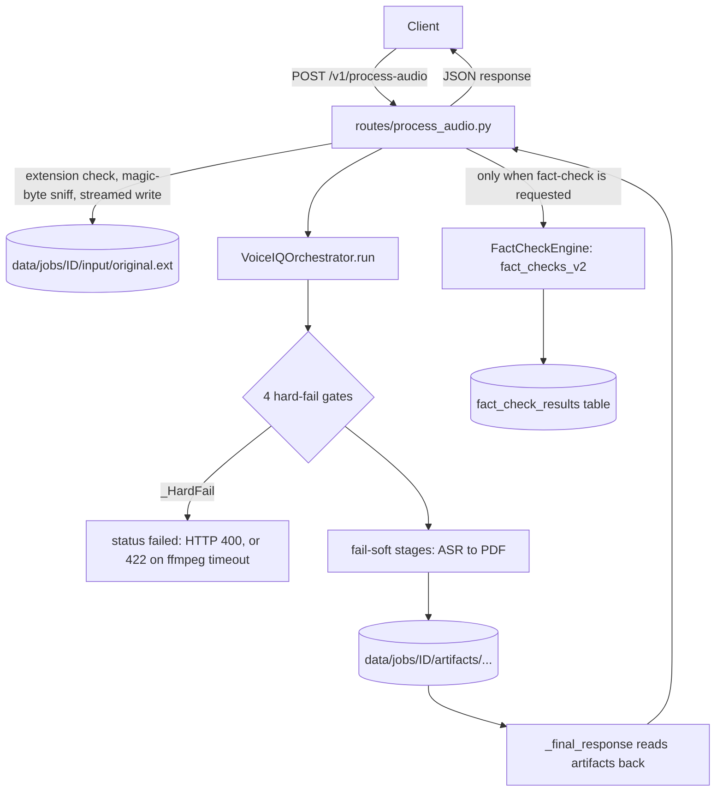

Last verified: 2026-10-16, 793e02e
# Architecture

This document describes the code structure of VoiceIQ at commit `793e02e`
(branch `sprint7/doc-sync`). It shows how the packages fit together, how data
moves between them, where faults are contained, what is stored, and how to
extend the system without breaking it.

[02-architecture.md](02-architecture.md) is the historical Sprint 1–4 view.
It was written before the fact-check engine, the Agent Brain and the
orchestrator decomposition, so use this document for the current state.
Anything that exists only as a plan is labelled **planned, not built**.

Related: [CLAUDE.md](../CLAUDE.md) (project brief), [README.md](../README.md),
[DATA-FLOW.md](DATA-FLOW.md) (every egress point), [SECURITY.md](SECURITY.md),
[DECISIONS.md](DECISIONS.md).

---

## 1. Two entry points

There are two FastAPI apps. They share the Insight Service and the Agent
Brain. Only one of them can process audio.

| | `app/main.py` | `app/insight_main.py` |
|---|---|---|
| Purpose | Full pipeline: audio in, analysis out | Insight Service and Agent Brain only, no audio stack |
| Routers mounted | process-audio and insights/fact-check under `/v1`, plus the Agent Brain router (`main.py:58-63`) | insights/fact-check under `/v1`, plus the Agent Brain router (`insight_main.py:70-74`) |
| Python dependencies | `requirements.txt` (includes whisper, torch, pyannote.audio, transformers) | `requirements-insight.txt` (FastAPI, SQLAlchemy, httpx, slowapi, fpdf; no ML libraries) |
| Startup (`lifespan`) | `init_db()`, then a sweep of expired job folders (`main.py:28-36`) | the same (`insight_main.py:41-47`) |
| Run by | no bundled config; start it when `/v1/process-audio` is needed | the bundled `Dockerfile` (`Dockerfile:89`) |

Both apps serve `/healthz` and `/version` directly on the app, outside the
protected routers (`main.py:66-77`, `insight_main.py:77-88`). Both turn off
`/docs`, `/redoc` and `/openapi.json` when `environment` is `production`
(`main.py:41-46`, `insight_main.py:52-57`).

## 2. Package map

```
app/main.py ─┬─ app/routes/process_audio.py ── app/pipeline/orchestrator.py ─┬─ app/services/*
             │                                                               ├─ app/insights  (adapter + InsightService)
             │                                                               └─ app/agent_brain (opt-in stage + callback)
             ├─ app/insights/api      (insights + fact-check routers, under /v1)
             └─ app/agent_brain/api   (internal router, /internal/v1/agent-brain)

app/security  guards that every router declares as FastAPI dependencies
app/utils     per-job workspace, logging, audio helpers, upload and fact-check gates
```

| Package | Role | Key files |
|---|---|---|
| `app/routes` | The only audio route, `POST /v1/process-audio` | `process_audio.py` |
| `app/pipeline` | Runs the audio pipeline stage by stage | `orchestrator.py` (`VoiceIQOrchestrator`, `_PipelineState`, `_HardFail`) |
| `app/services` | One class per pipeline step: ASR, diarization, alignment, metadata stats, sentiment, keywords, gender, emotion, topic, summary, intent, flags, legacy fact-check candidates, PDF | `asr_service.py`, `diarization_service.py`, `alignment_service.py`, `pdf_service.py`, … |
| `app/insights/core` | Insight engines: analytics, signal aggregation, rule engine, timeline, escalation, inconsistency, scoring, summary, normalizer, validator; shared `clamp` in `_math.py` | `rule_engine.py`, `_math.py` |
| `app/insights/core/factcheck` | Rule-based fact-check engine: claim detector, classifier, comparator, scorer, engine, and five source clients | `factcheck_engine.py`, `claim_detector.py`, `source_clients/` |
| `app/insights/models` | Pydantic models, one file per concern | `input_models.py`, `insight_models.py`, `factcheck_models.py`, … |
| `app/insights/api` | Insight and fact-check routers, combined into one router (`api/__init__.py:10-12`) | `insight_routes.py`, `factcheck_routes.py` |
| `app/insights/repository` | SQLAlchemy engine, ORM models and two repositories | `db.py`, `orm_models.py`, `factcheck_orm_models.py`, `insight_repository.py`, `factcheck_repository.py` |
| `app/insights/config` | `InsightSettings` (env prefix `VOICEIQ_`, `settings.py:28-38`) and default insight thresholds (`defaults.py`) | `settings.py`, `defaults.py` |
| `app/insights/adapters` | Turns orchestrator output into a `SessionInput` (`voiceiq_adapter.py:52`) | `voiceiq_adapter.py` |
| `app/insights/service.py` | `InsightService`: validate, then analytics → rules → summary | `service.py` |
| `app/agent_brain/core` | Five rule-based agents plus confidence refinement, de-duplication, ranking and the runner | `agent_runner.py`, `base_agent.py`, `*_agent.py` |
| `app/agent_brain/extraction` | Signal matching, assignee, date/time phrase, deadline resolution, priority, language routing | `signals.py`, `datetime_resolver.py`, `language.py` |
| `app/agent_brain/models` | Input (`AgentContext`) and output (`Recommendation`) contracts, camelCase on the wire (`models/base.py`) | `agent_context.py`, `recommendation.py`, `enums.py` |
| `app/agent_brain/adapters` | Builds an `AgentContext` from `SessionInput`, `InsightBundle` and an optional `FactCheckResponse` | `pipeline_adapter.py` |
| `app/agent_brain/integrations` | HMAC-signed callback to the Java Action Layer | `java_callback_client.py` |
| `app/agent_brain/api`, `config`, `service.py` | Internal route, `AgentBrainSettings` (env prefix `VOICEIQ_AGENT_`, `config/settings.py:14`), `AgentBrainService` | |
| `app/security` | API-key check, Content-Length cap, rate limits | `api_key.py`, `payload_size.py`, `rate_limit.py` |
| `app/utils` | `JobIO` per-job workspace, logging setup, ffmpeg normalisation, audio-quality check, magic-byte sniff, upload filename check, fact-check opt-in gate | `job_io.py`, `logger.py`, `audio_utils.py`, `audio_quality.py`, `audio_sniff.py`, `upload.py`, `factcheck_gate.py` |

Two modules sit outside the request path: `app/evaluation/evaluator.py` is
used by the repository-root script `run_eval_dev.py` (line 8), and
`app/models/response_model.py` is not imported by any module under `app/`.

## 3. Routes

| Route | Declared at | Mounted by |
|---|---|---|
| `POST /v1/process-audio` | `app/routes/process_audio.py:118` | `main.py` only |
| `POST /v1/insights/generate` | `app/insights/api/insight_routes.py:54` | both apps |
| `POST /v1/insights/generate-from-raw` | `insight_routes.py:74` | both apps |
| `GET /v1/insights/{session_id}` | `insight_routes.py:94` | both apps |
| `GET /v1/insights/{session_id}/summary` | `insight_routes.py:112` | both apps |
| `GET /v1/insights/{session_id}/speakers` | `insight_routes.py:137` | both apps |
| `GET /v1/insights/{session_id}/timeline` | `insight_routes.py:165` | both apps |
| `GET /v1/insights/` | `insight_routes.py:188` | both apps |
| `DELETE /v1/insights/{session_id}` | `insight_routes.py:199` | both apps |
| `POST /v1/fact-check` | `app/insights/api/factcheck_routes.py:79` | both apps |
| `GET /v1/fact-check/{conversation_id}` | `factcheck_routes.py:117` | both apps |
| `POST /internal/v1/agent-brain/recommendations/generate` | `app/agent_brain/api/agent_routes.py:38` | both apps (mounted in `df8eec3`, added to the light app in `1774209`) |
| `GET /healthz`, `GET /version` | `main.py:66,71`; `insight_main.py:77,82` | each app |

Each router declares its guards as FastAPI dependencies from `app/security`
(for example `process_audio.py:54-59`, `insight_routes.py:33-40`,
`agent_routes.py:25-33`). What the guards do, and their limits, is covered in
[SECURITY.md](SECURITY.md). Request and response fields: [05-api-reference.md](05-api-reference.md)
(historical) and the route code.

## 4. Data flow: `POST /v1/process-audio`



### 4.1 Route, before the pipeline

`process_audio()` (`app/routes/process_audio.py:118-231`) does this, in order:

1. Creates a request id (a UUID) that is also the job id (`:132`).
2. Checks the filename extension against `.mp3`, `.wav`, `.m4a`, `.flac`
   (`app/utils/upload.py:15-36`); a bad or missing name is HTTP 400 (`:137-140`).
3. Runs the hourly, fail-soft sweep of expired job folders (`:38-48`, `:143`)
   and creates the job workspace `data/jobs/<job_id>/` (`app/utils/job_io.py:32-72`).
4. Streams the upload to `input/original<ext>` in 1 MB chunks, checks the
   first bytes for a known audio signature (`app/utils/audio_sniff.py:15`) and
   counts bytes against the upload cap (`:153-198`). Results: 415 for
   non-audio content, 413 when the cap is passed mid-stream, 500 with a fixed
   message when the write fails.
5. Calls `VoiceIQOrchestrator(job_io=io).run(...)` (`:200-207`).
6. If `pipeline_meta.status` is `failed`, raises 422 when the warnings
   contain `AUDIO_NORMALIZATION_TIMEOUT`, otherwise 400 (`:209-222`).
7. Adds `fact_checks_v2` (see 4.4) and returns the result (`:226-231`).

### 4.2 Orchestrator and `_PipelineState`

`VoiceIQOrchestrator.run()` (`app/pipeline/orchestrator.py:151-228`) is a flat
sequence of `_run_<stage>` calls. All state that one stage produces and a
later stage reads lives in one mutable dataclass, `_PipelineState`
(`orchestrator.py:79-137`): 7 per-run context fields (job paths, `meta`, job
id, speaker hints, Whisper model, language) and 25 stage-output fields, in
production order. It also carries three helpers: `warn(code)` (adds a
warning once), `timing(name, start)` and `skip(name)`.

The `meta` dict holds `warnings`, `timings_ms`, `skipped_steps` and `status`
(`orchestrator.py:161-168`). It is saved as `meta.json` at the end of the run
or when a gate fails. This structure came from the E2 decomposition
(`e81ca02` introduced `_PipelineState`, `a1e9ef7` the `_HardFail` gates).

Each stage writes its outputs under `data/jobs/<job_id>/artifacts/`. The
audio, ASR, diarization, alignment, insights, Agent Brain and PDF stages also
write a `*.status.json` file; stats and most NLP stages write one only when
they fail (for example `orchestrator.py:527-529`). Some stages read earlier
artifacts back from disk; for example, alignment loads `asr/whisper.json` and
`diarization/diarization.json` (`orchestrator.py:446-447`).

### 4.3 Stage sequence

The order below is the production order. The test harness pins it through
the insertion order of `timings_ms` (`app/insights/tests/test_orchestrator.py:121-140`,
asserted at `:957`).

| # | Method (`orchestrator.py` line) | `timings_ms` key | On failure | Warning code(s) | Imported inside the method |
|---|---|---|---|---|---|
| 1 | `_run_input_gate` (239) | — | **hard fail** | `MISSING_INPUT_AUDIO` | — |
| 2 | `_run_normalize` (250) | `audio_normalize` | **hard fail** | `AUDIO_NORMALIZATION_TIMEOUT`, `AUDIO_NORMALIZATION_FAILED` | — (ffmpeg subprocess) |
| 3 | `_run_audio_quality` (300) | `audio_quality` | **hard fail** if silent or near-silent; any other error is soft | `AUDIO_SILENT_OR_NEAR_SILENT`; soft: `AUDIO_QUALITY_FAILED` | `analyze_audio_quality` |
| 4 | `_run_asr` (347) | `asr` | soft | `ASR_FAILED` | `ASRService` |
| 5 | `_run_diarization` (391) | `diarization` | soft, falls back to single-speaker mode | `DIARIZATION_FAILED_FALLBACK` | `DiarizationService` |
| 6 | `_run_alignment` (443) | `alignment` | soft; skipped if ASR or diarization output is missing | `ALIGNMENT_FAILED` | — |
| 7 | `_run_stats` (493) | `stats` | soft | `STATS_FAILED` | — |
| 8 | `_run_sentiment` (515) | `sentiment` | soft | `SENTIMENT_FAILED` | `SentimentService` |
| 9 | `_run_keywords` (532) | `keywords` | soft | `KEYWORDS_FAILED` | `KeywordService` |
| 10 | `_run_gender` (549) | `gender` | soft; skipped on low SNR | `GENDER_FAILED` | `GenderService` |
| 11 | `_run_emotion` (569) | `emotion` | soft; skipped on low SNR | `EMOTION_FAILED` | — (`EmotionService` guards its own torch import) |
| 12 | `_run_topic` (591) | `topic` | soft | `TOPIC_FAILED` | `TopicService` |
| 13 | `_run_summary` (605) | `summary` | soft | `SUMMARY_FAILED` | `SummaryService` |
| 14 | `_run_intent` (618) | `intent` | soft | `INTENT_FAILED` | — |
| 15 | `_run_factcheck` (636) | `factcheck` | soft | `FACTCHECK_FAILED` | — (legacy regex candidate scan, no network) |
| 16 | `_run_flags` (647) | `flags` | soft | `FLAGS_FAILED` | — |
| 17 | `_run_insights` (660) | `insights` | soft | `INSIGHTS_FAILED` | — |
| 18 | `_run_agent_brain` (717) | `agent_brain` | soft; off unless `agent_brain_auto_run` | `AGENT_BRAIN_FAILED` | Agent Brain adapter and service (callback modules inside `_dispatch_agent_callback`) |
| 19 | `_run_pdf` (852) | `pdf` | soft | `PDF_FAILED` | — |

The table lists failure codes. Stages also record codes that are not
failures, such as skip codes (`ALIGNMENT_SKIPPED_MISSING_INPUT`,
`orchestrator.py:451`; `GENDER_SKIPPED_LOW_SNR`, `orchestrator.py:556`) and
`SINGLE_SPEAKER_MODE` (`orchestrator.py:441`).

How the stages connect:

- Sentiment, keywords, gender and emotion each enrich `speaker_segments` in
  turn and save a copy. `_final_response` picks the most-enriched saved file
  (`orchestrator.py:889-894`).
- `_run_insights` calls `VoiceIQInsightAdapter.from_orchestrator(...)` and then
  `InsightService.generate(...)`. It keeps the typed `SessionInput` and
  `InsightBundle` on the state for the Agent Brain stage
  (`orchestrator.py:660-715`).
- `_run_agent_brain` (added in `f5e4d84`) builds an `AgentContext` with
  `PipelineAdapter.to_context(..., fact_check=None)` and runs
  `AgentBrainService` (`orchestrator.py:717-787`). Because `fact_check` is
  `None`, `FactCheckReviewAgent` produces nothing on this path; the docstring
  explains why (`orchestrator.py:725-733`). The stage then hands the result to
  `_dispatch_agent_callback` (added in `f619f7d`), which does nothing unless a
  callback URL and a secret are both set (`orchestrator.py:811-813`). When it
  runs, it drops recommendations below `min_confidence` and sends the rest on
  a daemon thread, off the request path (`orchestrator.py:789-850`). The
  request is HMAC-signed; the signature scheme is specified in
  [JAVA-CALLBACK-V2.md](JAVA-CALLBACK-V2.md).
- `_run_pdf` renders the legacy `fact_checks` list from stage 15
  (`orchestrator.py:865`). The PDF does not include `fact_checks_v2` or the
  Agent Brain recommendations.

`_final_response` (`orchestrator.py:882-965`) builds the response from the
saved artifacts, not from memory. The `recommendations` key is present only
when the Agent Brain stage wrote its artifact (`orchestrator.py:910-913`,
`963-964`).

### 4.4 Fact-check enrichment, after the pipeline

The route, not the orchestrator, runs the Sprint 5 fact-check engine, and
only after `run()` returns:

- `factcheck_requested(fact_check)` decides whether to run it. The per-request
  `?fact_check=` value wins; otherwise the `factcheck_auto_enrich` setting
  decides, and it defaults to off (`app/utils/factcheck_gate.py:24-38`,
  `app/insights/config/settings.py:193`).
- When it is off, `fact_checks_v2` is a `disabled` stub (`factcheck_gate.py:18-21`).
- When it is on, `_auto_run_factcheck` (`process_audio.py:62-115`) cuts the
  transcript to `MAX_TRANSCRIPT_CHARS` (10,000, `factcheck_models.py:155`),
  runs the shared engine, checks the payload as strict JSON (no NaN or
  Infinity), saves the rows on a best-effort basis, and sets `fact_checks_v2`.
  An empty transcript gives a `skipped` stub.

The response therefore has two fact-check keys: `fact_checks` (legacy
candidate scan, made inside the pipeline) and `fact_checks_v2` (Sprint 5
engine, added by the route). Egress for each is listed in
[DATA-FLOW.md](DATA-FLOW.md).

## 5. Data flow: standalone routes

**Insights** (`app/insights/api/insight_routes.py`). `POST /generate` takes a
validated `SessionInput`; `POST /generate-from-raw` takes a loose dict that
`InsightService.generate_from_raw` validates and normalises first
(`service.py:108-160`). Both call `InsightService.generate` and save the
response through `InsightRepository.save` (`insight_routes.py:43-51`). The
`GET` and `DELETE` routes only read or delete stored records. Unlike the
fact-check routes, saving here is not wrapped in a `try/except`, so a
repository error reaches the caller.

Inside `InsightService.generate` (`service.py:34-105`):

```
parse / validate input ─► InsightAnalyticsEngine.run
                       ─► InsightRuleEngine.run:
                            signal aggregation → speaker insights → timeline
                            → escalation → inconsistency (adds timeline markers)
                            → session flags → scoring
                       ─► InsightSummaryEngine.run
                       ─► InsightGenerateResponse
```

The rule engine order is in `rule_engine.py:23-98`. The timeline must come
before escalation, because escalation reads the timeline markers
(`rule_engine.py:41-43`).

**Fact-check** (`app/insights/api/factcheck_routes.py`). `POST /v1/fact-check`
runs one process-wide `FactCheckEngine`, built once from settings
(`factcheck_routes.py:61-66`, `factcheck_engine.py:68-84`). The engine runs:

```
ClaimDetector.detect (regex; drops a claim whose number has over 15 digits, claim_detector.py:119, 190)
  → ClaimClassifier.classify
  → per claim: SourceRouter.client_for(claim_type) → client.fetch (TTL cache)
               → FactCheckComparator.compare → FactCheckScorer.score
  → FactCheckResponse + stats
```

Claim types map to clients as follows: `CURRENCY_RATE` to exchangerate.host,
`CRYPTO_PRICE` to CoinGecko, `STOCK_PRICE` to Alpha Vantage, `WEATHER` to
OpenWeather, `STATIC_FACT` to the Wikipedia REST client. `COMMODITY_PRICE` has
no client, so it gets `UNSUPPORTED_CLAIM_TYPE` (`factcheck_engine.py:68-84`,
`172-185`). The currency client sends no access key, and the provider now
requires one, so currency claims end as `SOURCE_UNAVAILABLE` with the reason
stated (`forex_client.py:1-8`, `dc03a44`). Provider status:
[FACT-CHECK-AGENT-STATUS.md](FACT-CHECK-AGENT-STATUS.md).
`GET /v1/fact-check/{conversation_id}` lists stored rows (`factcheck_routes.py:117-131`).

**Agent Brain** (`app/agent_brain/api/agent_routes.py`). The route takes a
camelCase `AgentContext` and returns `AgentBrainService.generate(context)`
(`agent_routes.py:38-41`). `AgentRunner.run` collects candidates from five
agents (Task, Follow-Up, Email Draft, Escalation, Fact-Check Review;
`agent_runner.py:19-26`), refines each confidence, removes near-duplicates
and ranks by priority, then confidence (`agent_runner.py:42-50`,
`ranker.py`). This route never calls the Java callback; only the pipeline
stage does ([DATA-FLOW.md](DATA-FLOW.md)).

## 6. Fault boundaries

The repository uses two fault models, chosen by topology. A linear chain
(the insight engines) fails loudly, because a silently missing middle stage
would corrupt everything after it. An independent fan-out (agents, claims)
contains each fault, because the other parts' results are still correct.
[CLAUDE.md](../CLAUDE.md) ("Orchestration + fault isolation") gives the
reasoning; do not harmonise the two.

| Boundary | Where | Rule | Pinned by |
|---|---|---|---|
| Four hard-fail gates | `orchestrator.py:67-76`, `183-188` | Only `MISSING_INPUT_AUDIO`, `AUDIO_NORMALIZATION_TIMEOUT`, `AUDIO_NORMALIZATION_FAILED` and `AUDIO_SILENT_OR_NEAR_SILENT` stop the run. Each gate sets `status="failed"`, saves `meta.json` and raises `_HardFail`; `run()` catches it once. | `test_exactly_four_hard_fail_gates` (`test_orchestrator.py:1003`) |
| Fail-soft stages | every other `_run_<stage>` | Catch, record a warning code and a status file, continue. A late failure never changes `status` from `ok`. | `test_late_stage_exception_never_flips_status` (`test_orchestrator.py:959`) |
| `InsightService` | `service.py:63-105` | The single boundary for the insight engines. One `try/except` around analytics → rule → summary turns any engine fault into a `status="error"` response that keeps the validation result. `InsightRuleEngine.run` deliberately has no `try/except` (`rule_engine.py:23-98`). | — |
| `AgentRunner` | `agent_runner.py:52-59` | Per-agent `try/except`: a failing agent is logged and skipped, and the other agents' recommendations are still returned. | `test_per_agent_fault_isolation` (`app/agent_brain/tests/test_agent_runner.py:41`) |
| Fact-check, per claim | `factcheck_engine.py:228-247`, `187-194` | A client fault, an unusable reply or a non-finite value means no evidence. The comparator then returns `SOURCE_UNAVAILABLE` for that claim only, and the run continues. Clients return `None`, or raise only `SourceUnavailable` with a short reason (`base_client.py:48-58`). Hardened in `9aff207`. | `test_one_bad_reply_affects_only_its_own_claim`, `test_engine_contains_a_client_that_breaks_its_contract`, `test_fact_check_api_never_500s_on_a_bad_reply` (`test_factcheck_source_replies.py:338`, `365`, `406`) |
| Fact-check persistence on `/v1/fact-check` | `factcheck_routes.py:105-112` | A `FactCheckRepositoryError` is logged; the verdicts are still returned. | — |
| Fact-check inside process-audio | `process_audio.py:62-115` | Never fails the audio response. An engine error, or a payload that is not strict JSON, gives a `failed` stub in `fact_checks_v2`, and an unrenderable payload is not saved. A save failure is logged and the payload is still returned. The strict-JSON check came in `8e51a94`. | `test_process_audio_degrades_fact_checks_v2_instead_of_failing`, `test_process_audio_never_500s_on_an_unrenderable_fact_check`, `test_process_audio_never_saves_an_unrenderable_fact_check` (`test_factcheck_source_replies.py:458`, `775`, `793`) |
| Java callback | `orchestrator.py:789-850` | Fire-and-forget daemon thread. A failure is logged with the error class and HTTP status only, never the URL or the payload (`cedfe96`). | `test_callback_failure_never_propagates` (`app/agent_brain/tests/test_pipeline_callback.py:163`); the Java callback section of `app/insights/tests/test_logging_hygiene.py` |
| Outbound request logging | `app/utils/logger.py:4-15` | The `httpx` and `httpcore` loggers are pinned to WARNING, so request URLs (which can carry keys and claim subjects) stay out of INFO logs (`c1b35d9`). | `test_logging_hygiene.py` |
| Job retention | `job_io.py:127-163`, `process_audio.py:38-48` | The sweep never raises into the caller: folders are removed with `ignore_errors=True`, and an `OSError` on a folder is logged and that folder skipped (`job_io.py:153-160`). | `test_removal_error_is_fail_soft` (`app/insights/tests/test_job_retention.py:82`) |

## 7. Persistence

There are two kinds of storage.

**Per-job files.** `JobIO` writes everything for one request under
`data/jobs/<job_id>/`: `input/`, `artifacts/<stage>/…`, `logs/`, `meta.json`
(`job_io.py:32-72`). `purge_expired(job_retention_hours)` deletes old job
folders at startup and at most once an hour from the audio route
(`main.py:35`, `process_audio.py:30-48`).

**Database.** SQLAlchemy, by default SQLite at `./data/insights.db`
(`settings.py:62`). There are exactly two tables:

| Table | ORM model | Written by | Read by |
|---|---|---|---|
| `insight_records` | `InsightRecordORM` (`orm_models.py:33`); one row per `session_id`, payload stored as JSON | `POST /v1/insights/generate`, `/generate-from-raw` | `GET`/`DELETE /v1/insights/*` |
| `fact_check_results` | `FactCheckResultORM` (`factcheck_orm_models.py:33`); one row per claim result | `POST /v1/fact-check`; `/v1/process-audio` when fact-check runs | `GET /v1/fact-check/{conversation_id}` |

`/v1/process-audio` does not write to `insight_records`. Its insight output
goes only to the job folder (`orchestrator.py:681`).

**No migrations.** `init_db()` calls `Base.metadata.create_all()`
(`db.py:110-130`), which creates missing tables and never alters an existing
one. There is no Alembic or other migration tool in the repository. Setting
`VOICEIQ_DATABASE_AUTO_CREATE=false` skips table creation entirely
(`db.py:120-121`, `settings.py:73`). `app/insights/tests/test_db_schema_evolution.py`
(`ff84664`) pins this: an existing table is not widened, the mismatch is
silent, and missing tables are created.

## 8. Extension points

### 8.1 Adding a pipeline stage

1. Add a `_run_<stage>(self, st)` method and any new `_PipelineState` fields.
   Call the method from `run()` at its place in the order
   (`orchestrator.py:190-224`).
2. Make it fail-soft: wrap the work in `try/except`, call `st.warn("<CODE>")`,
   save a `<stage>.status.json`, and call `st.timing("<stage>", t0)`. Never
   raise `_HardFail`; only the four gates may (`orchestrator.py:230-237`).
3. Import heavy libraries **inside the method**, never at module scope. The
   module-scope imports must stay light so `test_orchestrator.py` runs on
   `requirements-insight.txt` (`orchestrator.py:13-23`; `9e57cb4`). Treat a
   service as heavy if it imports an ML library or loads a model artifact.
4. In `test_orchestrator.py`, add the timing key to `ALL_TIMINGS` (`:121-140`),
   add a stage test class, and mock any heavy service (`:237-255`).
5. If the stage adds a response key, read its artifact in `_final_response`.
   Follow the `recommendations` pattern and leave the key out when the
   feature is off (`orchestrator.py:910-913`).

### 8.2 Adding an insight engine

1. Use the layout `core/<feature>_engine.py`, `models/<feature>_models.py`
   and `tests/test_<feature>.py` ([CLAUDE.md](../CLAUDE.md), standard 1).
2. Call it from `InsightRuleEngine.run` (`rule_engine.py:23-98`), respecting
   data dependencies. Do not add a `try/except` there: `InsightService` is
   the single fault boundary (`service.py:63-105`).
3. Handle missing upstream data (empty sessions, no sentiment) with safe
   defaults. That is different from catching engine faults.
4. Clamp every score with `app/insights/core/_math.py:clamp`, and give every
   output a `reason` and `evidence` (for example `insight_models.py:33-34`,
   `60-63`).

### 8.3 Adding an Agent Brain agent

1. Subclass `BaseAgent` (`app/agent_brain/core/base_agent.py:13`), set
   `agent_type` and `action_type`, and implement `detect(context)`. It must
   be pure and stateless, and return `[]` when nothing matches.
2. `AgentType` and `ActionType` are `Literal` types in `models/enums.py`.
   Their values appear in every `Recommendation` (`models/recommendation.py:47-48`),
   which the internal route returns and the callback sends
   (`recommendation.py:79-85`), camelCase, for the Java Action Layer. A new
   member therefore changes that contract.
3. Register it in `default_agents()` (`agent_runner.py:19-26`). The runner
   isolates its faults; the agent does not need its own catch-all.
4. Take vocabulary from a language-keyed table through
   `extraction/language.py` (`resolve_language`, `vocabulary_for`). Only the
   `"en"` keys are populated; do not invent Urdu or Arabic terms
   ([N4B-MULTILINGUAL-STRATEGY.md](N4B-MULTILINGUAL-STRATEGY.md)).
5. If it reads fact-check claims, note that `PipelineAdapter._VERDICT_TO_STATUS`
   is total with no default (`pipeline_adapter.py:41-48`), pinned by
   `test_verdict_map_is_total` (`app/agent_brain/tests/test_pipeline_adapter.py:97`).

### 8.4 Adding a fact-check source client

1. Subclass `BaseSourceClient` (`base_client.py:60`), set `name`, and
   implement `fetch(claim) -> Evidence | None`.
2. Never raise from `fetch`, except `SourceUnavailable(reason)`. Keep the
   reason short, with no URLs, keys, response bodies or claim text
   (`base_client.py:48-58`, `80-87`).
3. Fetch through `self._get_json(...)`, which handles retries and rejects
   non-finite, non-object or undecodable replies (`base_client.py:107-176`).
   Read values with `_finite_float` and `_as_dict`. Accept an injected
   `httpx.Client` so tests can mock the transport (`base_client.py:66-74`).
4. Register it in `SourceRouter.from_settings` under an existing `ClaimType`
   (`factcheck_engine.py:68-84`). PHASE-0 §2.1 sets the rules for changing
   `ClaimType` or `Verdict`; read it before adding a member
   ([FACTCHECK-AGENT-PHASE-0.md](FACTCHECK-AGENT-PHASE-0.md)).
5. Add any API-key or timeout setting to `app/insights/config/settings.py`
   and `.env.example`. A new destination is a new egress point, so update
   [DATA-FLOW.md](DATA-FLOW.md) in the same change.
6. Never log the request URL or claim text. The engine's warnings carry
   only the client name, the claim id and, for an unexpected exception, the
   error class (`factcheck_engine.py:192`, `242`, `245`).

## 9. Sprint 7 fact-check agent — planned, not built

**Everything in this section is planned, not built.** No Sprint 7
application code exists at `793e02e`. A search of `app/` at that commit finds
no `/v2` route, no `fact_check_report` key and no `factcheck_agent_*` table.
For progress and the next milestone, see
[FACT-CHECK-AGENT-STATUS.md](FACT-CHECK-AGENT-STATUS.md). For each
decision and its status, see the
[decision register](FACTCHECK-AGENT-PHASE-0.md#1-decision-register).

| Planned element (planned, not built) | Described in | Part of today's code it would touch |
|---|---|---|
| New routes `POST /v2/fact-check` and `GET /v2/fact-check/{runId}`, with their own models; v1 routes and models unchanged | PHASE-0 §2.1, §2.2 | a new router beside `factcheck_routes.py` |
| Job-based run: `/v1/process-audio` returns before the agent finishes | PHASE-0 §D2 | `process_audio.py`, after `orch.run` |
| New `fact_check_report` response key, a state envelope (`pending`, `complete`, `failed`, `disabled`, `skipped`), next to the unchanged `fact_checks` and `fact_checks_v2` | PHASE-0 §2.3 | the process-audio response |
| Four new tables: `factcheck_agent_runs`, `factcheck_agent_claims`, `factcheck_agent_evidence`, `factcheck_agent_citations`; existing tables not altered | PHASE-0 §4 | `create_all()` in `db.py:130` would create them |
| When the job ends, re-run the Agent Brain, then the PDF, with the Java callback sent exactly once, on the final pass | PHASE-0 §D10 | `_run_agent_brain`, `_dispatch_agent_callback`, `_run_pdf` |
| New egress destinations: a model server and a search backend | PHASE-0 §3 | [DATA-FLOW.md](DATA-FLOW.md) would change |

Planned flow (planned, not built):

```
POST /v1/process-audio ── orchestrator.run
    ├─ Agent Brain, first pass: fills the response; no callback when a job will follow
    └─ returns with fact_check_report.status = "pending"
fact-check job ── writes the factcheck_agent_* rows
    └─ on a terminal state: re-run Agent Brain (final pass, sends the callback) → re-run PDF
GET /v2/fact-check/{runId} ── collect the run
```

What the current code does in its place: the in-pipeline Agent Brain
passes `fact_check=None`, so `FactCheckReviewAgent` is dormant on that path
(`orchestrator.py:725-733`, `763`), and the PDF shows only the legacy
`fact_checks` list (`orchestrator.py:865`). The code contains no job runner.
How the job will run is open and tracked in
[FACT-CHECK-AGENT-STATUS.md](FACT-CHECK-AGENT-STATUS.md).
